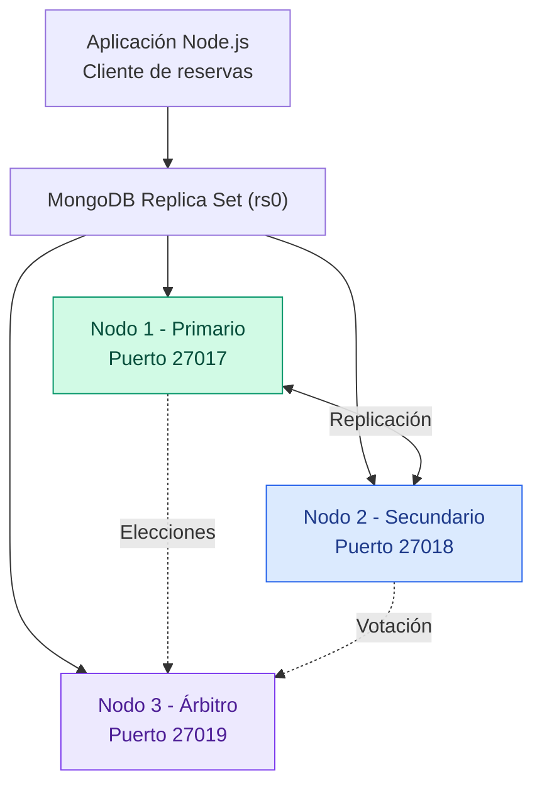

# Reporte Técnico - Fase 3: Resiliencia, Transacciones y Securización

## 1. Diagrama de Arquitectura

El sistema utiliza un clúster distribuido de MongoDB configurado como un Replica Set (`rs0`) para proporcionar alta disponibilidad y tolerancia a fallos.

## 2. Bitácora del Failover
* **Estado Inicial:** El nodo Primario (puerto `27017`) procesa las operaciones de escritura y lectura de la aplicación de reservas. Los nodos Secundario y Árbitro sincronizan el estado mediante latidos continuos (*heartbeats*).
* **Simulación de Caída:** Se interrumpe de forma abrupta el proceso del nodo Primario (`mongod` en puerto `27017`) para emular un fallo crítico de servidor.
* **Proceso de Elección y Conteo:** Al perder la conexión con el Primario, el nodo Árbitro (puerto `27019`, que no almacena datos pero emite voto) y el nodo Secundario (puerto `27018`) inician un proceso automático de votación basado en prioridades.
* **Promoción:** El nodo Secundario es promovido exitosamente a nuevo nodo Primario en pocos segundos, garantizando la continuidad operativa y la tolerancia a fallos sin pérdida de disponibilidad del servicio.

## 3. Código de la Transacción ACID Multi-documento
Para garantizar la consistencia absoluta en el proceso crítico de reservas (verificación de stock, descuento de cupos e inserción del registro de la reserva en paralelo), se implementó la API de transacciones de MongoDB. 
* El código completo se encuentra en la carpeta `/scripts/transaccion_reserva.js`.
* Utiliza `session.startTransaction()` para asegurar atomicidad. En caso de cumplirse una regla de negocio inválida o error técnico, se ejecuta `session.abortTransaction()` (Rollback completo) dejando la base de datos intacta; de lo contrario, se consolida mediante `session.commitTransaction()`.

## 4. Reporte de Securización (*Security by Design*)
* **Autorización Obligatoria:** Se configuró el archivo `mongod.conf` activando `security.authorization: "enabled"` para bloquear por completo el acceso anónimo al clúster.
* **Principio de Privilegios Mínimos:** Se crearon cuentas diferenciadas:
  * Un usuario administrador con privilegios de gestión global en la base de datos `admin`.
  * Un usuario específico (`appReservasUser`) con el rol estricto `readWrite` limitado únicamente a la base de datos del proyecto (`sistema_reservas`).
* **Inmunidad contra Accesos No Autorizados:** Cualquier intento de consulta o inserción anónima externa sin autenticación válida es rechazado de inmediato por el motor de la base de datos, previniendo vulnerabilidades de exposición comunes.
